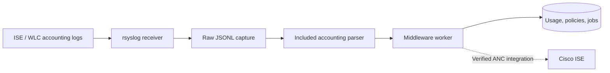

# rsyslog installation and middleware integration

Use this guide for **CachyOS collection tests** and **Ubuntu Server deployment** on `codex/updated-middleware-workflow`. You can install and test the receiver before installing the middleware database or configuring any ISE credentials.

The receiver captures raw logs, and the included **[rsyslog accounting parser](rsyslog-parser.md)** connects supported messages directly to the middleware worker. Real deployment samples are still needed to verify your ISE format and endpoint semantics. Normalized/RADIUS JSONL exporters remain supported as alternatives.



## Contents

1. [Choose the host, addresses, and port](#1-choose-the-host-addresses-and-port)
2. [Install rsyslog](#2-install-rsyslog)
3. [Get the receiver configuration](#3-get-the-receiver-configuration)
4. [Install the configuration for your OS](#4-install-the-configuration-for-your-os)
5. [Include, validate, and start](#5-include-validate-and-start)
6. [Test collection locally](#6-test-collection-locally)
7. [Choose TCP or UDP and change the port](#7-choose-tcp-or-udp-and-change-the-port)
8. [Accept the real sending node](#8-accept-the-real-sending-node)
9. [Configure firewall and ISE forwarding](#9-configure-firewall-and-ise-forwarding)
10. [Capture the accounting samples](#10-capture-the-accounting-samples)
11. [Connect accounting to the middleware](#11-connect-accounting-to-the-middleware)
12. [Complete ANC enforcement](#12-complete-anc-enforcement)

References: [troubleshooting](#troubleshooting), [retention and migration](#retention-and-migration), [verification](#verification).

## 1. Choose the host, addresses, and port

Run the operating-system commands on the machine that will **receive logs**. Your current CachyOS workstation can receive test logs; the planned production receiver is Ubuntu Server. Each host needs its own receiver configuration and log directory. Installing rsyslog on one does not configure the other.

| Setting | Initial local test | Example network collection |
| --- | --- | --- |
| Receiver OS | CachyOS or Ubuntu | Ubuntu Server, or CachyOS for a temporary test |
| Listening address | `127.0.0.1` | Receiver's actual LAN address, for example `10.20.30.20` |
| Trusted sender | `127.0.0.1` | Actual sending ISE node, for example `10.20.30.10` |
| Transport/port | TCP `5514` | Same transport and port on receiver, sender, and firewall |
| Raw output | `/var/log/bandwidth-engine/ise-raw.jsonl` | Same path on the selected receiver |

The `10.20.30.x` addresses are examples; replace them with your own. You can finish the loopback test while the LAN and ISE addresses are undecided. Find assigned IPv4 addresses with:

```bash
ip -br -4 address
```

Choose the appropriate Ethernet/Wi-Fi address for network collection. Use a stable address or DHCP reservation for a lasting ISE logging target.

Port `5514` is the incoming syslog receiver in this example. ISE's HTTPS **ANC API port `9060`** is a separate outbound connection from the middleware. Existing WLC-to-ISE RADIUS accounting also has its own settings; changing the syslog listener does not change those.

## 2. Install rsyslog

### CachyOS

If rsyslog is already installed, check it and continue to step 3:

```bash
rsyslogd -v
command -v logger
```

For a fresh installation, first check whether your configured CachyOS/Arch repositories offer the package:

```bash
pacman -Si rsyslog
```

If it is available there, install it as part of a full package update:

```bash
sudo pacman -Syu --needed rsyslog nano
```

If the package is unavailable in those repositories, the alternative is the [rsyslog AUR package](https://aur.archlinux.org/packages/rsyslog). Build as your normal user after reviewing its `PKGBUILD` and any install files:

```bash
sudo pacman -Syu --needed base-devel git nano
mkdir -p ~/builds
cd ~/builds
git clone https://aur.archlinux.org/rsyslog.git
cd rsyslog
less PKGBUILD
makepkg -si
```

Use the package source appropriate to your system; repository availability and AUR build requirements can change. If the build directory already exists, review and update that checkout instead of cloning over it. `makepkg` runs as your normal user and requests installation privileges when needed.

### Ubuntu Server 24.04 LTS

```bash
sudo apt update
sudo apt install -y rsyslog nano
rsyslogd -v
command -v logger
getent passwd syslog
getent group syslog
```

The Ubuntu package provides the `syslog` user/group used by the supplied receiver. CachyOS may run rsyslog as root and have no `syslog` account; the next steps handle that difference.

## 3. Get the receiver configuration

If you already have this repository, open a terminal in its root directory and use the current workflow branch. Run Git as the checkout's owner; for a root-owned Ubuntu deployment, use the administrative Git workflow in the [Ubuntu guide](ubuntu-server.md#update-the-server).

```bash
git fetch origin
git switch codex/updated-middleware-workflow
git pull --ff-only
```

For a new normal-user checkout:

```bash
cd ~
git clone --branch codex/updated-middleware-workflow https://github.com/DaemionBladee/Bandwidth-Limitation-Middleware.git
cd Bandwidth-Limitation-Middleware
```

The repository is private: use your authorized credential helper, GitHub token, or SSH authentication. Keep credentials out of clone URLs and configuration files.

All relative paths below start at the repository root. The common receiver source is [deploy/rsyslog/30-bandwidth-engine.conf](../deploy/rsyslog/30-bandwidth-engine.conf). It includes the JSON template, trusted-sender check, TCP listener, and file permissions. No Python environment or database is needed to copy and test this file.

If you already have a working receiver, retain its custom addresses/port and follow the relevant sections below. Before replacing an existing configuration, back it up **outside** the included rsyslog configuration directory.

## 4. Install the configuration for your OS

### CachyOS with the default root service

First inspect the service identity and create the directory that may be missing on CachyOS:

```bash
systemctl show rsyslog.service -p User -p Group
sudo install -d -m 0755 /etc/rsyslog.d
sudo grep -RniE 'PrivDropTo(User|Group)' /etc/rsyslog.conf /etc/rsyslog.d
```

Empty systemd `User`/`Group` values mean systemd starts the service as root. Also check the last command for rsyslog's own active privilege-drop settings; commented examples are inactive, and no matches is normal. The following commands apply when the effective rsyslog identity is root, as in the successful CachyOS local test:

```bash
sudo install -d -o root -g root -m 0750 /var/log/bandwidth-engine
sudo install -m 0644 deploy/rsyslog/30-bandwidth-engine.conf /etc/rsyslog.d/30-bandwidth-engine.conf
sudo sed -i \
  -e 's/fileOwner="syslog"/fileOwner="root"/g' \
  -e 's/fileGroup="syslog"/fileGroup="root"/g' \
  /etc/rsyslog.d/30-bandwidth-engine.conf
sudo grep -iE 'fileOwner|fileGroup' /etc/rsyslog.d/30-bandwidth-engine.conf
```

The final command must show `fileOwner="root"` and `fileGroup="root"`. This avoids `ID for user 'syslog' could not be found`. If your service uses another account, use that account and its permitted group for the directory and file settings instead. The file-ownership parameters do not change the daemon's service identity.

### Ubuntu Server

```bash
sudo install -d -m 0755 /etc/rsyslog.d
sudo install -d -o syslog -g syslog -m 0750 /var/log/bandwidth-engine
sudo install -m 0644 deploy/rsyslog/30-bandwidth-engine.conf /etc/rsyslog.d/30-bandwidth-engine.conf
sudo grep -iE 'fileOwner|fileGroup' /etc/rsyslog.d/30-bandwidth-engine.conf
```

Keep `fileOwner="syslog"` and `fileGroup="syslog"` on the standard Ubuntu setup. Inspect custom service/privilege-drop settings if you have changed its identity.

## 5. Include, validate, and start

Open the main configuration:

```bash
sudo nano /etc/rsyslog.conf
```

Ensure it loads `/etc/rsyslog.d/*.conf` once. An existing `$IncludeConfig /etc/rsyslog.d/*.conf` is sufficient. If no include loads that directory, add:

```rsyslog
include(file="/etc/rsyslog.d/*.conf" mode="optional")
```

Save Nano with **Ctrl+O**, **Enter**, then **Ctrl+X**. Keep one copy of the Bandwidth receiver; duplicate files such as `30-cisco-ise.conf` and `30-bandwidth-engine.conf` containing the same definitions will conflict. Move obsolete copies/backups outside the included directory after reviewing them.

The receiver loads `imtcp`. If your main configuration already loads it, retain one module load and remove the duplicate from the receiver file. Review the shared template's global `maxMessageSize="128k"` against any existing message-size setting.

Validate before restarting:

```bash
sudo rsyslogd -N1 && sudo systemctl restart rsyslog.service
sudo systemctl enable rsyslog.service
sudo systemctl status rsyslog.service --no-pager
```

`active (running)` establishes process state. `enabled` only means it is enabled for startup; it does not prove the process is running. If validation fails, resolve its error before starting/restarting the service.

Newer rsyslog versions, including the reported CachyOS 8.2610 build, can warn that `streamdriver.mode="0"` uses plain TCP. This is distinct from the missing-account error. The supplied listener is plain TCP for the initial loopback test. TLS needs the appropriate driver, certificates, peer validation, and matching ISE settings; changing global secure defaults alone does not configure those.

## 6. Test collection locally

The unchanged listener and sender filter both use `127.0.0.1`. Check TCP port `5514` and send a message:

```bash
sudo ss -lntp 'sport = :5514'
logger --tcp --server 127.0.0.1 --port 5514 --tag bandwidth-test 'Receiver connectivity test'
sudo tail -n 1 /var/log/bandwidth-engine/ise-raw.jsonl
```

Allow a moment for the receiver to write the record. Expected fields include:

```json
{"received_at":"2026-11-10T09:00:00+06:30","reported_at":"2026-11-10T09:00:00+06:30","source_ip":"127.0.0.1","hostname":"receiver-host","raw_message":"... bandwidth-test ... Receiver connectivity test"}
```

This demonstrates local transport, JSON encoding, and file output. It does not demonstrate ISE accounting, subscriber creation, quota usage, or ANC enforcement. Use the parser preflight before enabling accounting ingestion. Keep `ISE_MODE=mock` until ANC configuration is verified.

## 7. Choose TCP or UDP and change the port

Edit the installed receiver:

```bash
sudo nano /etc/rsyslog.d/30-bandwidth-engine.conf
```

The TCP listener is:

```rsyslog
input(type="imtcp" address="127.0.0.1" port="5514" ruleset="bandwidth_raw_capture")
```

Change `port="5514"` to your chosen available port, for example `port="1514"`. Change the same port in your test command, firewall rule, and ISE logging target. Validate/restart after saving. For that example:

```bash
sudo rsyslogd -N1 && sudo systemctl restart rsyslog.service
sudo ss -lntp 'sport = :1514'
logger --tcp --server 127.0.0.1 --port 1514 --tag bandwidth-test 'Alternate TCP port test'
sudo tail -n 1 /var/log/bandwidth-engine/ise-raw.jsonl
```

If the actual ISE target uses **UDP**, replace the Bandwidth module/input with:

```rsyslog
module(load="imudp")
input(type="imudp" address="127.0.0.1" port="5514" ruleset="bandwidth_raw_capture")
```

Keep the template, ruleset, sender filter, and ownership settings. Keep one load of each module used by the host. Validate/restart and test UDP instead:

```bash
sudo rsyslogd -N1 && sudo systemctl restart rsyslog.service
sudo ss -lnup 'sport = :5514'
logger --udp --server 127.0.0.1 --port 5514 --tag bandwidth-test 'UDP receiver test'
sudo tail -n 1 /var/log/bandwidth-engine/ise-raw.jsonl
```

Choose the transport supported by your ISE logging target. UDP has no delivery acknowledgement; lost accounting messages can affect usage totals. The template does not configure TLS. Where secure syslog is required, configure and verify TLS on both ends, including the actual appliance's certificate/peer requirements, before carrying production traffic.

## 8. Accept the real sending node

Once addresses are assigned, replace the two loopback values with their **different roles**. For the example receiver `10.20.30.20` and sender `10.20.30.10`, the ruleset check becomes:

```rsyslog
if $fromhost-ip != "10.20.30.10" then stop
```

The TCP input becomes:

```rsyslog
input(type="imtcp" address="10.20.30.20" port="5514" ruleset="bandwidth_raw_capture")
```

For UDP use `imudp` instead. The `address` must belong to the receiver; use the actual source IP of the sending ISE node in the filter. If an approved relay/NAT is involved, account for the source address seen by the receiver and establish trusted origin attribution through that relay.

For multiple legitimate senders, explicitly allow each one:

```rsyslog
if ($fromhost-ip != "10.20.30.10" and $fromhost-ip != "10.20.30.11") then stop
```

Validate/restart again and inspect the listener. After changing to a network address and ISE-only filter, the earlier localhost test will no longer prove remote collection: the listener/filter now target the real sender. `address="0.0.0.0"` would listen on all IPv4 interfaces, while the sender filter still applies; a specific LAN binding is easier to verify for this deployment.

## 9. Configure firewall and ISE forwarding

Use the firewall already managed on the receiver. The following rules use the example addresses and TCP port `5514`; replace them with your values and use `udp` if selected. Add every required sending node. Keep existing SSH and dashboard rules.

### UFW, when already in use

```bash
sudo ufw status
sudo ufw allow from 10.20.30.10 to 10.20.30.20 port 5514 proto tcp
```

### firewalld, when already in use

Identify the zone for the receiver's network interface:

```bash
sudo firewall-cmd --get-active-zones
```

If that zone is `public`, add the rule for the running and persistent configuration:

```bash
sudo firewall-cmd --zone=public --add-rich-rule='rule family="ipv4" source address="10.20.30.10" port port="5514" protocol="tcp" accept'
sudo firewall-cmd --permanent --zone=public --add-rich-rule='rule family="ipv4" source address="10.20.30.10" port port="5514" protocol="tcp" accept'
```

Use the actual active zone if different. Installing/enabling another firewall is not required by this guide. Any intervening network ACL also needs to permit the selected connection.

In the actual ISE version's **remote logging target** settings, configure:

| Setting | Example |
| --- | --- |
| Destination | Receiver LAN IP `10.20.30.20` |
| Transport | TCP, or the supported protocol you selected on the receiver |
| Destination port | `5514`, or your selected port |
| Logging categories | Relevant RADIUS accounting events containing session/counter data |

The WLC must already generate accounting Start, Interim-Update, and Stop information toward the appropriate accounting infrastructure. Assign the remote target to the appropriate accounting categories on the sending ISE nodes. Menu/category names and available transports depend on the actual ISE version; inspect that deployment's documentation instead of copying settings from another version. Authentication-only logs are insufficient for byte quotas.

Generate an authorized test subscriber session and inspect new captures:

```bash
sudo tail -f /var/log/bandwidth-engine/ise-raw.jsonl
```

Use Ctrl+C to stop following the file. A real record's `source_ip` should match an allowed sender. If nothing arrives, see the troubleshooting table before changing the accounting adapter.

## 10. Capture the accounting samples

Capture representative Start, Interim-Update, and Stop events. Preserve the relationships between messages when redacting subscriber identifiers. Verify that your records provide the supported field names and semantics for:

- Subscriber username and endpoint MAC/IP, plus NAS identity.
- Stable session/event IDs, timestamps/timezone, and any message sequence/fragment fields.
- Upload/download octets, gigawords or other counter-width information, and accounting status.
- Repeated/interim records and examples of fragmentation or resets when available.

`received_at` is receiver time; `reported_at` comes from rsyslog's parsed header. The included parser uses explicit accounting time, the CISE payload timestamp, or an offset-aware RFC5424 header, and handles its documented CISE fragmentation format. Verify those choices, trusted origin, session identity, and counter direction against the real deployment. Unsupported formats fail with diagnostics; see the [parser reference](rsyslog-parser.md).

The raw file can be read by root and the configured logging owner/group. When enabling direct rsyslog ingestion, grant the middleware process read-only access as described below. Log collection does not require ISE ERS credentials or changes to website Admin/User accounts.

## 11. Connect accounting to the middleware

The included `rsyslog` accounting source reads the capture directly; no additional parser daemon or intermediate file is required. Supported RFC5424/RFC3164, flat JSON/CSV accounting, and CISE formats are documented in the [parser reference](rsyslog-parser.md). Configure the parser only after inspecting a preflight result. A connectivity-test record is ignored and correctly produces zero quota usage.

### Grant read-only capture access

Install ACL tools if needed: `sudo pacman -Syu --needed acl` on CachyOS, or `sudo apt install acl` on Ubuntu. The raw capture should already exist from the local test. For a CachyOS middleware running as your normal login user, run these commands in Bash:

```bash
sudo setfacl -m "u:$(id -un):rx" /var/log/bandwidth-engine
sudo setfacl -m "u:$(id -un):r" /var/log/bandwidth-engine/ise-raw.jsonl
test -r /var/log/bandwidth-engine/ise-raw.jsonl
```

For the installed Ubuntu service account:

```bash
sudo setfacl -m u:bandwidth:rx /var/log/bandwidth-engine
sudo setfacl -m u:bandwidth:r /var/log/bandwidth-engine/ise-raw.jsonl
sudo -u bandwidth test -r /var/log/bandwidth-engine/ise-raw.jsonl
```

These ACLs grant access to the capture directory/file, not all system logs. Reapply appropriate access if an operator deliberately replaces the source during reconciliation. The service account does not need permission to modify the capture or to run as root.

### Configure and preflight

Set the middleware's untracked `.env`:

```dotenv
ACCOUNTING_SOURCE=rsyslog
ACCOUNTING_FILE=/var/log/bandwidth-engine/ise-raw.jsonl
RSYSLOG_ALLOWED_SENDERS=127.0.0.1,::1
RSYSLOG_FRAGMENT_TIMEOUT_SECONDS=900
ISE_MODE=mock
```

For real logs, replace `RSYSLOG_ALLOWED_SENDERS` with the actual ISE sender IPs/CIDRs, matching the receiver/network allowlist. The settings above are for the local test. The parser uses the receiver's raw envelope schema only when `ACCOUNTING_SOURCE=rsyslog`; do not use that file with `jsonl` or `radius-jsonl`.

From the repository on CachyOS:

```bash
uv run --frozen python -m bandwidth.cli check-syslog --file /var/log/bandwidth-engine/ise-raw.jsonl
```

From `/opt/bandwidth-engine` on Ubuntu:

```bash
sudo -u bandwidth .venv/bin/python -m bandwidth.cli check-syslog --file /var/log/bandwidth-engine/ise-raw.jsonl
```

Preflight prints line/parsed/ignored/pending counts without writing database records or calling ISE. It reports incomplete fragments/partial lines rather than pretending they are accounting. The [synthetic fixture](../tests/fixtures/rsyslog/README.md) can demonstrate parsing before real logs arrive.

### Start ingestion

Select an enabled **default quota plan** before discovering unknown usernames. On CachyOS, stop the existing `make dev` session and run `make dev` again. On Ubuntu, restart both processes:

```bash
sudo systemctl restart bandwidth-api.service bandwidth-worker.service
```

The existing worker now parses and ingests complete accounting messages. Fragment state, file checkpoint, usage, subscriber discovery, and enforcement jobs commit together. Existing subscribers retain their assignments and usage; reconnects do not grant a new allowance. Duplicate events do not increase quota usage. Retain the active capture append-only; see the source/checkpoint rules below.

Check checkpoint/parser counts through authenticated `/api/status` or dashboard snapshot responses, and inspect worker errors. The dashboard shows newly discovered subscribers and their measured usage. A file containing only receiver test messages produces no subscribers. With `ISE_MODE=mock`, enforcement confirmations remain simulations.

For an existing independent exporter, `ACCOUNTING_SOURCE=radius-jsonl` or `jsonl` remains available. Point those adapters at their own supported measurement file instead; see [accounting formats](api.md). Avoid changing between adapters/replaying the same feed into an existing ledger without reconciling source identity and deduplication scope.

## 12. Complete ANC enforcement

The operator-selected operation is:

```http
PUT https://<ISE-IP>:9060/ers/config/ancendpoint/apply
Accept: application/json
Content-Type: application/json
Authorization: Basic <constructed from server-side ERS credentials>
```

Use the [ISE deployment contract](ise.md) to configure verified connection values, the actual request body, speed-to-policy mapping, required reauthorization, and active-session confirmation. Credentials belong in the server's `.env` or secret store. The client constructs Basic authentication; the receiver file contains no ERS password.

ANC applies a policy to an endpoint. ISE authorization/WLC settings must make that policy produce the requested speed profile. The current adapter still needs verified MAC/IP identity bindings and support for the deployment's session model; its existing username binding is not a MAC/IP mapping. Establish the NORMAL reset action explicitly: applying a NORMAL policy or clearing the limited policy, according to the verified deployment.

Only then select live mode and restart both application processes. An ANC HTTP success or selected policy alone is not proof of applied bandwidth. Confirm the expected profile on the relevant active endpoint/session(s). The middleware does not configure WLC QoS directly.

## Troubleshooting

| Symptom | Check or correction |
| --- | --- |
| Nano: `No such file or directory` | Keep the editor buffer, create `/etc/rsyslog.d` in another terminal, then save. Ensure the main file includes the directory. |
| `fileOwner`: user `syslog` not found | On a default root-running CachyOS service, use `root:root` for the receiver file settings and directory. Ubuntu uses its installed `syslog` identity. Inspect custom privilege dropping. |
| Same ownership error after editing | Inspect the installed file named in the error. Another receiver file may still contain the old owner; use the ownership search in the diagnostic commands below. |
| Module/template/ruleset already defined | Keep one include and one receiver definition. Remove duplicate module loads. Store backups outside included paths. |
| Service is enabled but inactive/failed | Validate, then inspect `journalctl`; enabling only sets startup behavior. |
| `Address already in use` | Inspect `ss` for the chosen port, check duplicate listeners, or choose an available port and update sender/firewall together. |
| Plain TCP warning on rsyslog 8.2610 | Inspect the validation exit result and separate warnings from fatal errors. TLS requires driver/certificate/peer configuration on both ends. |
| Local test works, ISE sends nothing | Check LAN binding, actual sending node IP/filter, matching protocol/port, ISE category/target assignment, and host/network firewall. |
| Raw file grows, dashboard has no real usage | Enable `ACCOUNTING_SOURCE=rsyslog`, check sender allowlist/read permissions and preflight counts, then restart API/worker. Connectivity/authentication-only logs are ignored. |
| Normalized accounting user is unknown | Register it or configure an enabled default quota plan. The batch/checkpoint remains blocked on errors. |
| Future accounting timestamp error | Verify event-time parsing, timezone, and clock synchronization; do not replace event time with ingestion time. |
| Accounting file rotated/truncated | Follow the checkpoint rules below; preserve data and stop/reconcile the ingestion source before resuming. |

Useful diagnostics:

```bash
sudo rsyslogd -N1
sudo systemctl status rsyslog.service --no-pager
sudo journalctl -u rsyslog.service -n 50 --no-pager
sudo grep -RniE 'file(Owner|Group).*syslog' /etc/rsyslog.d
sudo ss -lntp 'sport = :5514'
sudo ss -lnup 'sport = :5514'
```

## Retention and migration

The active file consumed by any accounting adapter must satisfy its append-only checkpoint rules. With `ACCOUNTING_SOURCE=rsyslog`, that is the raw capture itself. Preserve it and its incomplete fragments while the worker reads it; do not add ordinary log rotation/replacement without controlled source reconciliation.

The current accounting adapters require their **active input file to remain append-only** and stores its device/inode identity plus byte offset in PostgreSQL. Truncation or replacement is rejected. Moving/copying that file to a new host/filesystem can change its identity even when its bytes are identical. Restoring the database checkpoint and copying the full file alone is therefore not enough to guarantee ingestion resumes.

For a migration, stop ingestion and take matched database/file backups. Keep the full processed prefix and stable record IDs. Resume only after an operator has reconciled the restored source identity/cursor through a controlled migration procedure or an adapter extension. There is no checkpoint-rebinding CLI in this branch. Do not clear checkpoints or delete accounting history to bypass the error.

Keep development and production accounting separate. Only the intended server should process the live feed and use live ISE credentials.

## Verification

The documented receiver configurations were exercised in an isolated Ubuntu 24.04 container: syslog-owned TCP on `5514`, root-owned TCP on `5514`, root-owned TCP on the alternate port `1514`, and root-owned UDP on `5514`. Each passed configuration validation, real `logger` delivery with synthetic messages, JSON capture, rejection of an untrusted sender, and owner/group/mode checks. Earlier Ubuntu capture checks also exercised long messages.

The reported CachyOS 8.2610 local TCP test succeeded after changing ownership to root. The root-mode container checks use Ubuntu's rsyslog build; CachyOS package installation and its complete host environment were not reproduced in the cloud workspace.

The parser is implemented and exercised with synthetic fixtures; actual ISE accounting format compatibility and live ANC enforcement have not been verified. Endpoint mapping and the live contract still depend on real deployment samples and capabilities. For application regression checks, see the [repository verification instructions](../README.md#verification).
