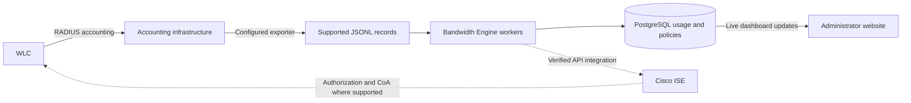

# Bandwidth Engine: website guide

Bandwidth Engine is an administrator website for managing subscriber data allowances, monitoring accounting usage, and coordinating normal or limited speed profiles through Cisco ISE.

The website manages policies and decisions. The WLC handles subscriber traffic and enforces the supported authorization settings returned through ISE. Actual usage must come from your configured accounting source.

## Contents

- [Features at a glance](#features-at-a-glance)
- [Website pages](#website-pages)
- [Quota policies and schedules](#quota-policies-and-schedules)
- [Default plan and automatic subscribers](#default-plan-and-automatic-subscribers)
- [Everyday subscriber tasks](#everyday-subscriber-tasks)
- [Administrator accounts](#administrator-accounts)
- [Reading change history](#reading-change-history)
- [Live updates and display preferences](#live-updates-and-display-preferences)
- [How the complete process works](#how-the-complete-process-works)
- [Where to configure each setting](#where-to-configure-each-setting)
- [Try the website locally](#try-the-website-locally)
- [Current integration boundaries](#current-integration-boundaries)
- [Troubleshooting](#troubleshooting)
- [Technical references](#technical-references)

## Features at a glance

| Feature | What you can do |
| --- | --- |
| Live overview | See registered subscriber totals, current allowance usage, limited modes, pending/failed enforcement, and worker activity. |
| Usage charts | Compare seven days of recorded upload, download, or combined transfer; select a day for its values. |
| Subscriber management | Register identities, search/filter/sort subscribers, assign policies, inspect history, and request reconciliation. |
| Quota policies | Set allowance, both speed modes, enabled status, period, timezone, and reset schedule. |
| Default quota plan | Create, read, edit, replace, or remove the plan used for newly registered/discovered subscribers. |
| Automatic onboarding | Create a subscriber and assign the enabled default when the configured accounting source first reports their username. |
| Individual allowances | Give subscribers separate usage totals even when they share one policy definition. |
| Scheduled renewal | Begin a fresh recurring allowance and request NORMAL at the next period boundary. |
| Manual usage reset | Grant one subscriber a fresh allowance, record a reason, and preserve earlier usage. |
| Enforcement visibility | Distinguish the requested mode from the confirmed applied state, errors, and attempts. |
| Visual change history | See activity counts, a seven-day chart, filters, and readable Before/After comparisons. |
| Administrator creation | Create individual admin accounts with current-password confirmation, password hashing, and audit history. |
| Personal preferences | Choose display timezone and light/dark theme; use desktop or mobile layouts. |
| Admin API | Automate supported policy/subscriber operations through authenticated endpoints. |
| Local simulation | Test accounting, quota decisions, and simulated ISE confirmation without an appliance. |

## Website pages

### Overview

The overview combines operational totals, charts, subscribers, and background processing status.

| Item | Meaning |
| --- | --- |
| Total subscribers | Identities registered in the middleware. This is not a count of clients currently connected to the WLC. |
| Quota usage | Combined upload/download in subscribers' current allowance views. It can decrease when allowances renew or are reset. |
| Limited subscribers | Subscribers whose requested operating mode is LIMITED. Check enforcement status for the applied result. |
| Needs attention | Subscribers with pending or failed enforcement. |
| Recorded transfer | Seven local calendar days of received accounting traffic, including traffic before allowance resets. |
| Enforcement chart | Distribution of normal, limited, pending/failed, and unassigned states. |
| Background activity | Accounting ingestion, quota decisions, period rollover, and enforcement checks. |
| Accounting input | Selected source, ingestion checkpoint, relevant worker errors, and mock submission when enabled. |

Recorded transfer measures accounting data, rather than a live speed test, radio signal quality, or WLC capacity.

### Subscribers

Each row shows the username, assigned policy/version, usage and remaining allowance, requested speeds, enforcement status, and next reset.

You can search by username or policy, filter by normal/limited/attention/unassigned, and sort by name, highest usage, or next reset. Lists are paginated in groups of 25.

Open **History** or click a subscriber name for a detail drawer. **Usage & resets** shows retained periods and manual resets. **Enforcement** shows attempts, their adapter, outcome, and any error. The row action menu also provides policy assignment, reconciliation, and usage reset.

### Policy library

Create and edit policies, search by name/timezone, and review allowance, speed profiles, schedules, and versions. The default-plan card controls automatic onboarding separately from ordinary edits for existing subscribers.

### Change history

Review administrative and automatic onboarding actions through a visual timeline. See [Reading change history](#reading-change-history).

### Administrators

View administrator usernames and create an individual account for another operator. Each account currently has full workspace access. See [Administrator accounts](#administrator-accounts).

## Quota policies and schedules

Choose **New policy**, enter the settings below, and save.

| Setting | Purpose | Example |
| --- | --- | --- |
| Policy name | Identify the plan. Names must be unique. | Standard monthly |
| Quota | Combined upload plus download allowance. The website accepts decimal GB. | 50 GB |
| Normal download/upload | Requested speeds while usage is below quota. The website accepts Mbps. | 20 / 10 Mbps |
| Limited download/upload | Requested speeds at or above quota. | 2 / 1 Mbps |
| Period | Daily, weekly, monthly, or custom. | Monthly |
| Policy timezone | Timezone used to calculate calendar boundaries. | Asia/Yangon |
| Local reset time | Wall-clock time for a daily/weekly/monthly boundary. | 00:00 |
| Day of month/week | Select the applicable recurring day. | Day 1 |
| Enabled | Whether the policy's quota decision is active. | Enabled |

The API stores quota in bytes and speeds in kbps: **50 GB = 50,000,000,000 bytes**, and **20 Mbps = 20,000 kbps**. Quotas and all speeds must be positive. Limited speeds must not exceed their corresponding normal speeds.

For an enabled, active period, the engine chooses NORMAL when `used_bytes < quota_bytes`, and LIMITED when `used_bytes >= quota_bytes`. Disabling a policy or assignment requests its NORMAL profile; it does not disconnect the subscriber.

### Recurring schedules

- **Daily:** renew at the configured local time every day.
- **Weekly:** renew on the selected weekday at the configured local time.
- **Monthly:** renew on the selected day. If the day is absent, use that month's final day. A day-31 policy renews on February's final day, then returns to day 31 in March.

Calendar boundaries follow the policy timezone. During daylight-saving changes, ambiguous times use the first occurrence; nonexistent times move forward by the DST gap. A local calendar day can therefore last 23 or 25 hours.

### Custom schedules

Set an explicit start and end with UTC offsets. A repeat interval is optional and measured in elapsed seconds. Repeated intervals cannot overlap.

A one-time interval, or a repeated schedule with gaps, requires an explicit expiry/gap action: NORMAL or LIMITED. An expired one-time interval does not create another allowance automatically.

### Applying ordinary policy edits

An ordinary **Edit policy** allows changes immediately or at each assigned subscriber's next period boundary. The first assignment must be immediate.

Immediate changes re-evaluate recorded usage within the resulting policy window; they do not inherently grant a fresh allowance. Next-period changes preserve the current allowance until activation. Previous policy versions and usage views remain in storage. Historical views can overlap after edits and should not be added together as independent traffic totals.

## Default plan and automatic subscribers

The default plan is the policy used when a subscriber is first registered or discovered. There is one workspace default selection; each subscriber receives an independent allowance.

### Create or select the default

1. Open **Policy library**.
2. Choose **Create default plan**, enter quota/speeds/schedule, and save. Alternatively, choose **Use as default** on an existing policy and confirm.
3. Confirm the card shows **AUTOMATIC ASSIGNMENT ON**.
4. Connect the real accounting source, or use mock accounting for local testing.

The demo command does not select a workspace default automatically. An administrator must choose it explicitly.

### What happens when a new WLC user connects

The WLC must send RADIUS accounting to your accounting infrastructure. A configured exporter/collector supplies supported records to the middleware. The first record for an unknown username creates the subscriber, assigns the enabled default, records the audit actions, and starts usage processing.

A RADIUS Start export can enroll the subscriber before any traffic is transferred. Include `Acct-Status-Type: Start`; missing octet counters are accepted as zero for Start only. Interim/Stop measurements require actual counters.

Registration happens when the accounting record reaches the middleware. A Wi-Fi connection alone, without this feed, does not create a subscriber. The middleware also does not automatically create authentication credentials in your subscriber database or ISE.

First discovery uses the earliest sample timestamp in the batch as the initial assignment time, so initial traffic is included. Backlogged discoveries use the currently configured default version. A returning username reuses the existing identity, policy assignment, and allowance. Reconnects, new sessions, and duplicate events never grant another quota.

### Edit, replace, pause, or remove

| Action | Effect on future subscribers | Effect on existing subscribers |
| --- | --- | --- |
| **Edit default plan** | Use the new policy version. | Keep their current assignments and usage. |
| **Use as default** on another policy | Use the newly selected plan. | Keep their existing plan. |
| Disable the default's policy | Pause automatic assignment/discovery. | Default-card edits preserve existing versions; ordinary policy edits follow their selected timing. |
| **Remove default** | Stop automatic assignment/discovery. | Keep assignments, allowances, policy records, and history. |

Existing unassigned users are not automatically backfilled when a default is selected. Assign their policy explicitly. Without an enabled default, an unknown accounting username stops its ingestion batch until the user is registered or a usable default is configured.

## Everyday subscriber tasks

### Add a subscriber manually

1. Choose **Add subscriber**.
2. Enter the exact accounting username, including any realm/domain. Matching is case-sensitive.
3. Choose **Create subscriber**.

An enabled default is assigned automatically. Otherwise, select a policy in the assignment dialog when policies are available. Registering a subscriber stores an accounting identity; it does not set their Wi-Fi password.

### Change an assignment

Open the subscriber's action menu or detail drawer and choose **Assign policy**. Select the policy, enabled status, and immediate or next-period application, then save. Existing usage/history remains available.

### Reset one subscriber's allowance

1. Open **History → Reset usage**, or choose **Reset usage** in the row menu.
2. Review the subscriber and current allowance.
3. Enter a reason and confirm.

The current allowance segment closes and a fresh one begins until the original scheduled reset. NORMAL is requested through the enforcement queue. Earlier usage, raw accounting records, cumulative counter baselines, and reset reasons remain available. Pending policy changes remain scheduled.

This explains why current quota usage can become zero while the seven-day transfer chart still shows earlier traffic. Resetting usage does not erase traffic or reactivate an expired custom interval. A confirmation based on an outdated period is rejected so you can review the current allowance first.

### Request reconciliation

Choose **Reconcile enforcement** when a subscriber's desired/applied state needs another check. This queues work for the worker; it is not an immediate guarantee that the WLC changed. Review the resulting attempt and confirmed state.

## Administrator accounts

### First account

Run `make bootstrap` from the repository terminal. It securely prompts for a new password and confirmation. No public registration endpoint is exposed, and existing accounts are not overwritten.

### Additional accounts

1. Sign in with an existing administrator account.
2. Open **Administrators → Create administrator**.
3. Enter a unique username, a 12–512 character password, and the matching confirmation.
4. Enter your own current administrator password.
5. Choose **Create account**.

The new administrator can sign in independently. Passwords are stored as salted scrypt hashes and excluded from API responses and audit history. Password fields clear when the dialog closes. Five failed current-password confirmations block this action for five minutes. Cookie-based requests also require CSRF protection; an automation token alone cannot create administrators.

All administrators have full workspace permissions. Administrator editing/deletion, password recovery, MFA, SSO, and separate viewer/operator roles are not currently provided. Subscriber accounts and administrator accounts are separate.

## Reading change history

The page shows the latest **100 retained events**. Summary counts describe that displayed history, and the activity chart counts events in that set over seven days. These are not all-time analytics.

Use search, category, actor, or chart-day filters to find events. Categories include plans/defaults, subscribers, assignments, usage/resets, enforcement, and administrator access.

Each event identifies the action, relevant subscriber/plan, acting administrator or service, and time. Expand **View change(s)** for a comparison such as:

| Parameter | Before | After |
| --- | --- | --- |
| Data allowance | 50 GB | 75 GB |
| Normal download | 20 Mbps | 30 Mbps |
| Policy timezone | UTC | Asia/Yangon |

Default-plan events explain that existing allowances are preserved. Ordinary policy edits show their application timing and affected subscriber count. Usage resets record their reason. Automatic discovery/default assignment identifies the accounting service as the actor.

The API retains structured audit data for integrations, while the website renders readable comparisons. Unchanged expanded events and active filters survive incoming live updates.

## Live updates and display preferences

Usage, subscriber, policy, default-plan, administrator, and audit changes appear through an authenticated server event stream. Normal operation does not require a page refresh. Search text, unfinished forms, filters, and unchanged expanded entries remain in place.

The connection indicator reports **Live updates**, **Connecting**, **Reconnecting**, or background pause. It describes the website's connection to the middleware, not connectivity to ISE or the WLC. The last received data stays visible during an interruption. Updates pause in a hidden tab and resume when it becomes visible. Expired/revoked sessions return to sign-in.

Use the globe button for **Display preferences**. Search timezone names/cities or UTC offsets, choose a display timezone and appearance, then apply. Preferences persist in the same browser. Desktop has a theme toggle; mobile can change appearance through preferences.

**Display timezone** changes displayed timestamps and the traffic chart's local day boundaries. **Policy timezone** changes when a subscriber's quota renews. Changing display preferences does not move policy reset times.

## How the complete process works



1. A subscriber authenticates through your existing WLC/ISE identity setup.
2. Accounting reports their identity, session, timestamp, and counters.
3. If new and an enabled default exists, the middleware creates the subscriber and assignment.
4. The worker normalizes counters, removes duplicates, calculates usage, and finds the relevant quota period.
5. The engine chooses NORMAL below quota and LIMITED at/above quota, then persists the desired state and durable enforcement job together.
6. With a verified live integration, the adapter updates the supported ISE policy selection, requests required reauthorization, and reads the active session back. Otherwise the mock adapter simulates this step.
7. The dashboard shows the new usage, decision, attempts, and confirmation separately.
8. A recurring boundary starts a fresh allowance and requests NORMAL; prior periods remain available.

Accounting ingestion, quota evaluation, rollover, and enforcement/reconciliation run in the background. The API and worker must both be running for the full workflow. Failed enforcement has bounded retries with backoff and later reconciliation; outdated jobs cannot override newer decisions.

Accounting intervals and processing/reauthorization delays mean some traffic can exceed a quota before the WLC applies the limited profile. Cumulative deltas are attributed to their sample timestamps, rather than estimating exactly when individual bytes crossed a boundary.

## Where to configure each setting

| Setting | Where |
| --- | --- |
| Quota, normal/limited speeds, policy timezone/schedule | **New policy**, **Edit policy**, or the default-plan form |
| Default selection | **Policy library → Default quota plan**, or **Use as default** |
| Individual policy assignment | Subscriber action menu/detail drawer |
| Display timezone/theme | Globe button → **Display preferences** |
| Additional administrator accounts | **Administrators → Create administrator** |
| PostgreSQL connection | Local `.env`: `DATABASE_URL`; local Compose also uses `POSTGRES_PASSWORD` |
| Accounting adapter | Local `.env`: `ACCOUNTING_SOURCE` and `ACCOUNTING_FILE` |
| ISE connection/credentials | Local `.env`: `ISE_MODE`, `ISE_BASE_URL`, `ISE_USERNAME`, `ISE_PASSWORD`, `ISE_CA_BUNDLE` |
| Verified API paths, payloads, profile mappings, confirmation fields | Local deployment contract referenced by `ISE_CONTRACT_FILE` |
| Worker interval, API timeout, retry limit | Local `.env`: `WORKER_INTERVAL_SECONDS`, `ISE_TIMEOUT_SECONDS`, `ENFORCEMENT_MAX_ATTEMPTS` |
| Secure cookies, session lifetime, optional automation token | Local `.env`: `COOKIE_SECURE`, `SESSION_HOURS`, `ADMIN_API_TOKEN` |
| WLC RADIUS, accounting, CoA, supported speed settings | Your WLC/ISE configuration, using the correct vendor/version documentation |

Connection credentials and deployment-specific API mappings are configured outside the website. Keep secrets in the local environment or secret store, not Git. Restart API and workers after environment/contract changes. Use HTTPS and `COOKIE_SECURE=true` outside local HTTP development.

## Try the website locally

Prerequisites: Python 3.12+, uv, and Docker with Compose v2 for the supplied PostgreSQL workflow. See the [README](../README.md#run-locally) for installation/startup details.

For a first setup, copy `.env.example` to `.env` only if `.env` does not already exist. From the repository:

```sh
make install db migrate
make bootstrap
make demo
make dev
```

Open `http://localhost:8000` on the machine running the application and sign in with your chosen administrator credentials. `make dev` starts the API and workers and applies migrations; it does not create an admin account itself.

The demo supplies **50 GB/month, 20/10 Mbps NORMAL, 2/1 Mbps LIMITED**, timezone UTC, resetting on day 1 at midnight. It also registers `demo@example.com`. The command can be repeated without replacing existing credentials or editing existing demo records.

To exercise the workflow with mock accounting and mock ISE:

1. In **Policy library**, select **Use as default** on the demo policy if you want a workspace default.
2. Open **Overview → Submit mock usage** and select the demo subscriber.
3. For an untouched demo allowance, submit 10 GB upload and 40 GB download, totaling exactly 50 GB. If usage already exists, adjust the submitted total accordingly.
4. Watch usage reach quota and the requested mode become LIMITED. The worker then shows a **MOCK** confirmation.
5. Open subscriber history and inspect the period/enforcement attempts.
6. Reset usage with a reason. Watch the fresh allowance and NORMAL request appear; earlier transfer stays in history.
7. Open **Change history** and inspect the readable reset event.

The website's mock form selects registered subscribers. To simulate discovery of an unknown username, use the authenticated mock accounting API with an enabled default, or supply a supported accounting file. See [API examples](api.md).

For existing installations, stop `make dev`, pull the branch update, and run `make dev` again. Existing accounts and stored data are preserved by the migrations. Reload the browser once after a frontend update.

## Current integration boundaries

| Capability | Current state |
| --- | --- |
| Dashboard, PostgreSQL, policies/defaults, subscriber usage, reset/history, admin creation, workers | Implemented. |
| Mock accounting and mock ISE | Runnable for development; results are simulations. |
| Normalized and RADIUS JSONL accounting | Implemented; requires a real exporter producing the supported format. |
| Raw syslog receiver/Cisco syslog parser | Not included. The collector/parser must be configured or implemented for the actual log format. |
| Subscriber database account synchronization | Not included. Accounting discovery creates middleware identities, not subscriber credentials. |
| Live Cisco ISE enforcement | Requires inspection of your version, enabled APIs, WLC capabilities, rules, profiles, and session readback before deployment. |
| XML APIs, alternate authentication, session/MAC-based paths, multiple simultaneous ISE sessions | Need adapter extensions if your deployment requires them. The current live framework expects Basic authentication, JSON responses, and one normalized active-session object per subscriber. |
| Direct WLC QoS configuration | Not provided; enforcement is coordinated through the verified ISE integration. |
| Live connected-client inventory, RF monitoring, speed tests, billing, subscriber self-service | Not provided. |
| General policy/subscriber deletion, admin account editing/deletion/recovery, fine-grained roles | Not provided in the current website. Default removal retains historical policy/usage records. |

An ISE request returning HTTP success does not by itself confirm a WLC applied the profile. Check the separately confirmed active-session state. **A mock confirmation is never live network enforcement.**

## Troubleshooting

| Symptom | What to check |
| --- | --- |
| Dashboard has no data | Create demo/manual data, or connect a real accounting export. Confirm the API, database, and worker are running. |
| A new WLC user does not appear | Verify an enabled default, exported Start/Interim records, exact usernames, file access, worker status, and ingestion errors. |
| Unknown user blocks ingestion | Configure an enabled default or register that username, then let the worker retry. |
| Usage reset but the chart still shows transfer | Expected: a fresh allowance preserves previous transfer records. |
| Default edited but an existing user is unchanged | Expected: default-card edits target future subscribers. Use an ordinary policy edit or individual reassignment to change existing users. |
| Live indicator reconnects | Check API reachability, browser/network connectivity, session validity, and streaming support in the reverse proxy. |
| LIMITED is requested but enforcement is pending/failed | Inspect attempts, worker errors, adapter mode, ISE mapping, credentials, reachability, and active-session readback. |
| Administrator creation fails | Check your current password, matching new passwords, unique username, valid session, and the five-minute confirmation throttle. |
| Scheduled reset seems offset | Check the policy timezone; display timezone controls presentation separately. |
| Export ingestion reports rotation/truncation | Retain/reconcile the old file and ingestion checkpoint. The current JSONL adapter expects append-only input. |

## Technical references

- [Setup, accounting semantics, worker behavior, and verification](../README.md)
- [Admin API and accounting record formats](api.md)
- [Cisco ISE deployment contract and integration requirements](ise.md)
- [ISE contract template](ise.contract.example.json) — placeholders must be replaced with verified deployment details.
- [Environment variable template](../.env.example) — example configuration, without live secrets.

Automated checks cover quota thresholds, duplicate/out-of-order/concurrent accounting, schedules, policy edits, rollover, resets, default-plan provisioning, admin authorization/creation, ISE failure/recovery simulations, and browser workflows. Use `make check` and `make test` as described in the README. Automated mock/transport tests do not establish that a real appliance has been configured or changed.
